# St. Petersburg paradox

Flip a fair coin until it lands heads. If that takes k flips, you win 2^k dollars.
Each outcome has probability 1/2^k and pays 2^k, so every outcome adds exactly $1
to the expected value and the expectation is infinite. Yet hardly anyone would pay
more than about $20 to play.

This project simulates the game at a large scale (10,000 players, a billion games
each) and plots what actually happens to the players.

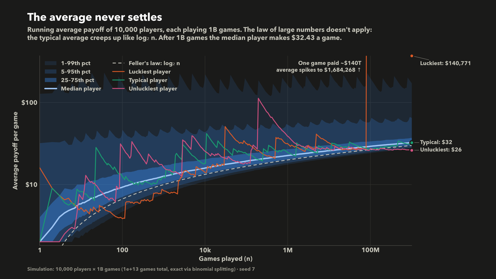

## Simulating 10^13 games

Flipping every coin for 10^13 games is not feasible, but the figures only need the
*sum* of m payoffs. Among m games, the number that end on the first flip is
Binomial(m, 1/2); of the rest, the number that end on the second flip is again
Binomial(remaining, 1/2), and so on. An exact draw of the sum therefore takes about
log2(m) binomial draws, vectorised across all players. The full simulation runs in
a few seconds (see `stpetersburg/simulation.py`).

## Figures

| | |
|---|---|
| 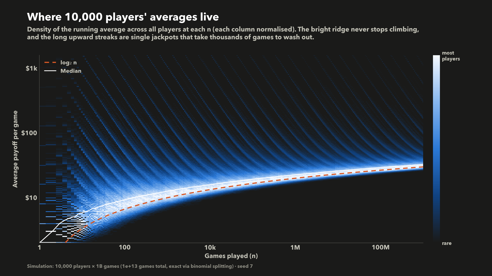 | 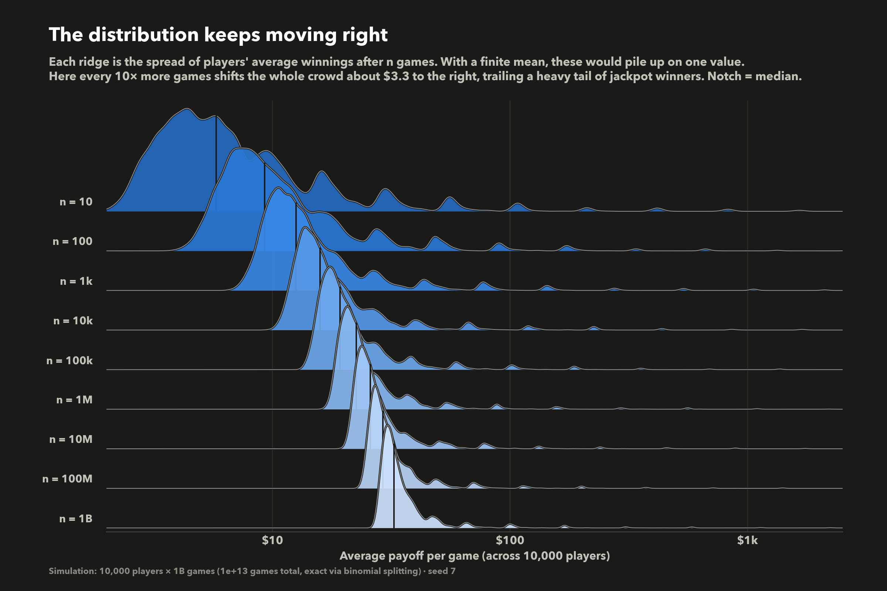 |
| 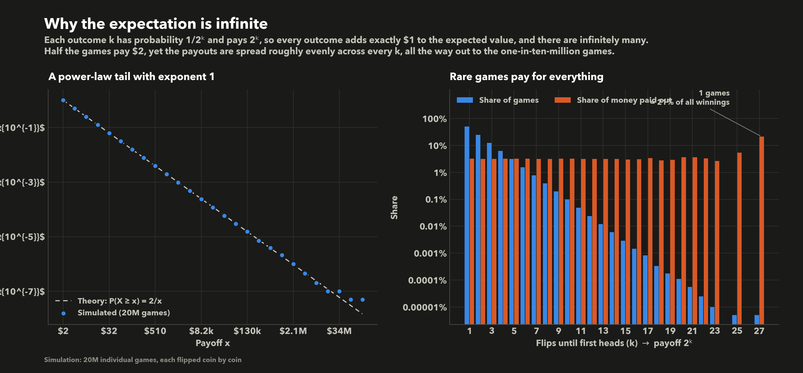 | 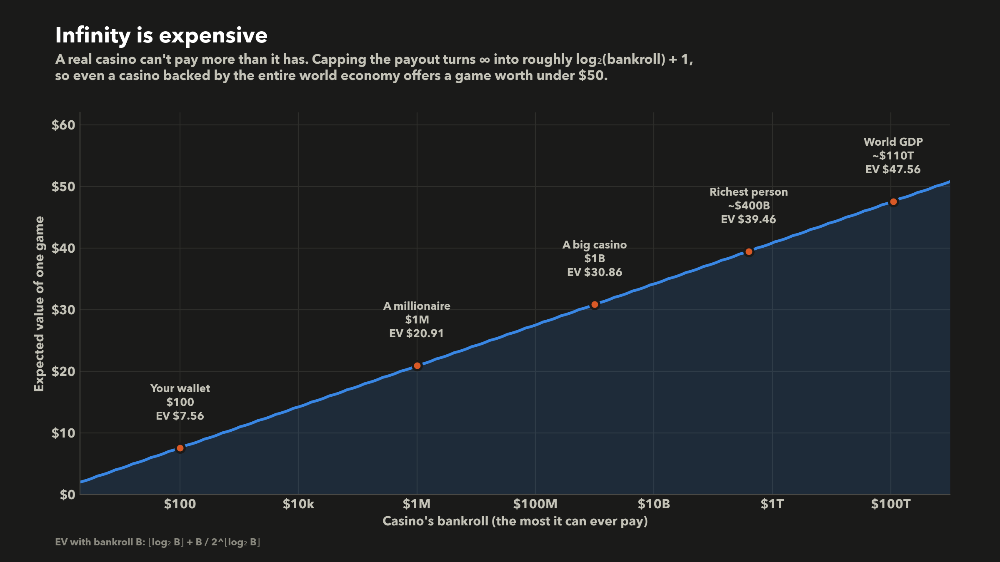 |
| 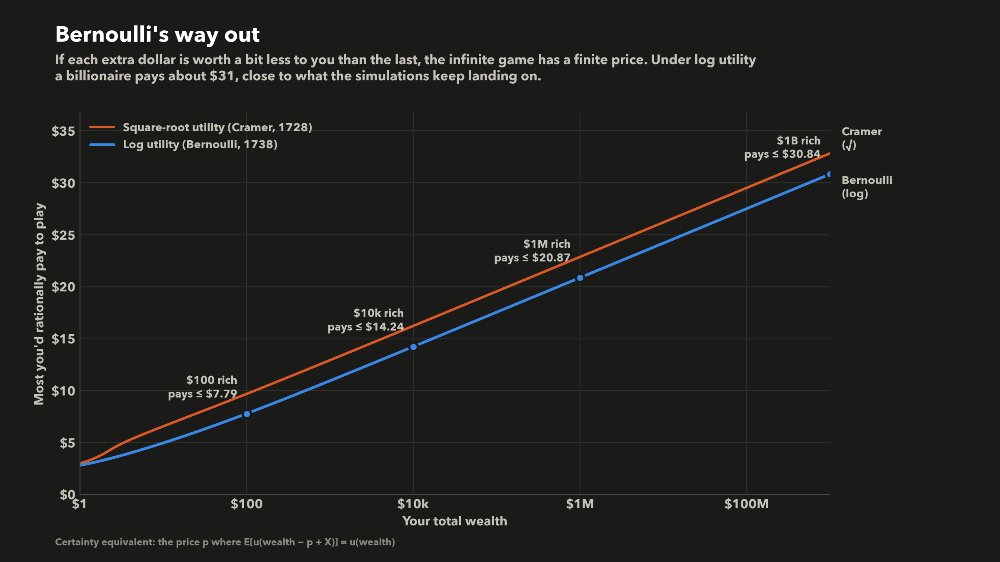 | 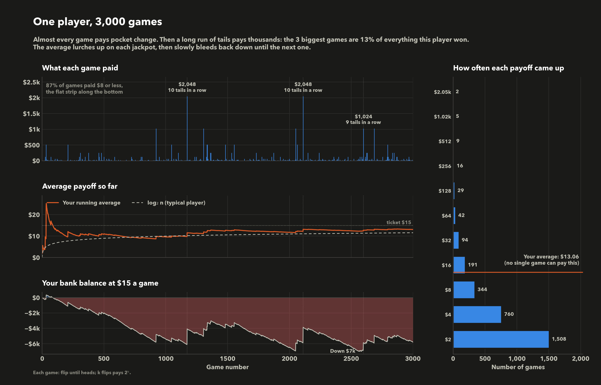 |
| 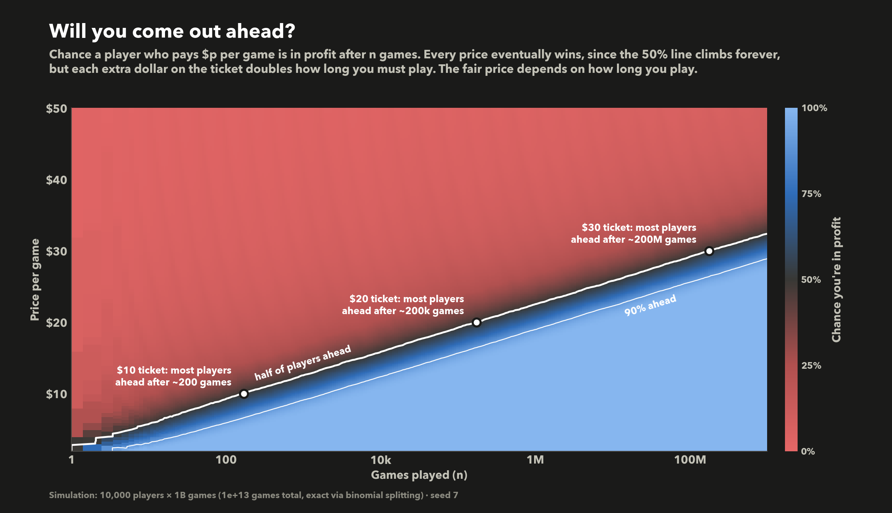 | 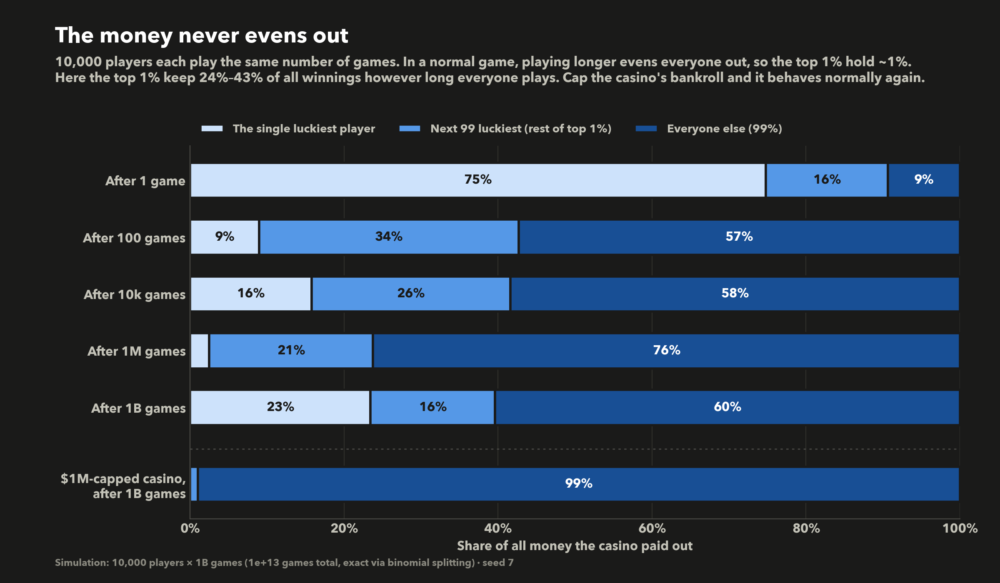 |
| 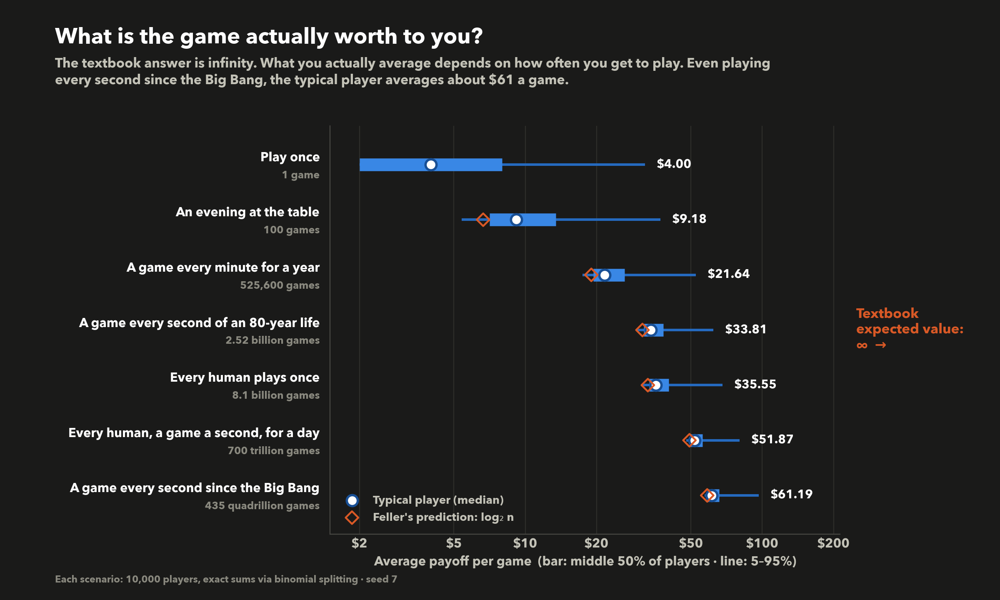 | 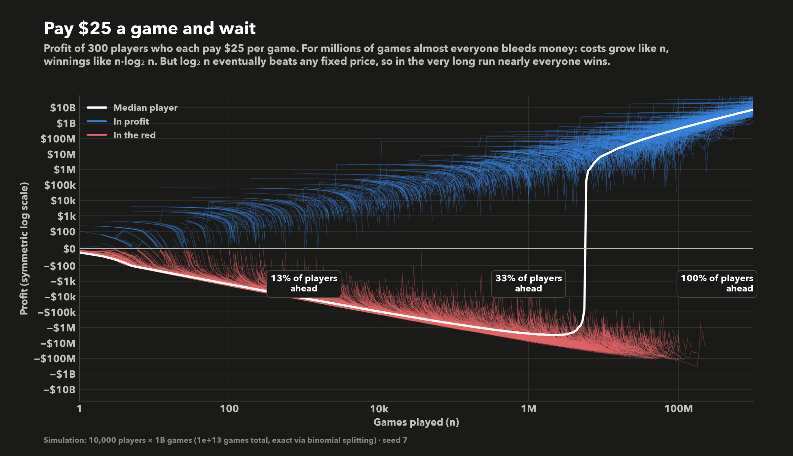 |

The main takeaways:

- **The average never settles.** The law of large numbers needs a finite mean.
  Instead, a typical player's average grows like log2(n) (Feller, 1945).
- **A finite casino fixes it.** Capping the payout at a bankroll B gives an
  expected value of roughly log2(B) + 1, under $50 even for world GDP.
- **So does diminishing utility.** Under Bernoulli's log utility, even a
  billionaire should pay only about $31 to play once.
- **The fair price depends on how long you play.** Every ticket price
  eventually turns a profit, but each extra dollar doubles how long that takes.

## Animations

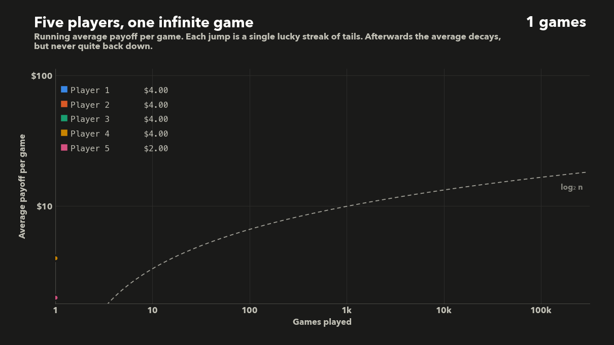

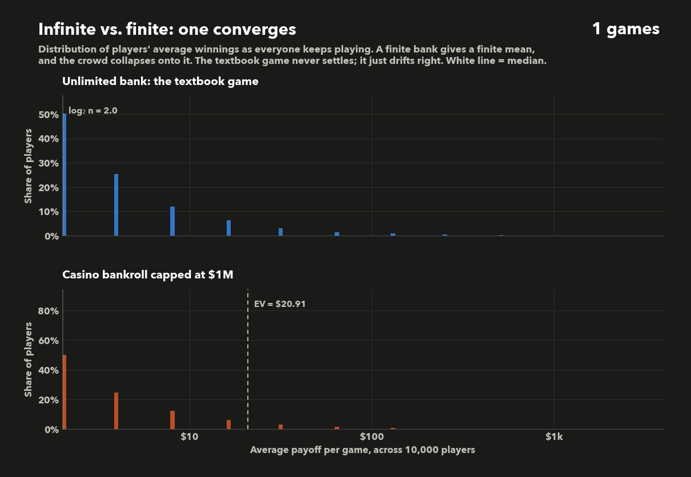

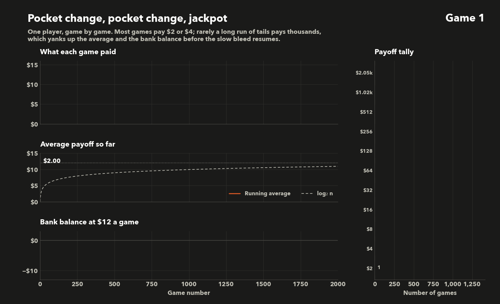

MP4 versions are in `output/`.

## Running it

```bash
pip install -r requirements.txt
python -m stpetersburg                # everything, into ./output
python -m stpetersburg --no-anim      # static figures only
python -m stpetersburg --only 05 07   # selected figures
python -m stpetersburg --paths 2000   # fewer players, faster
```

Static figures take a few seconds. The animations take a couple of minutes, and
MP4 output requires `ffmpeg` on the PATH. Each figure uses its own seeded random
stream, so `--only` reproduces exactly what a full run produces.

## Layout

```
stpetersburg/
  simulation.py       binomial-splitting simulator, capped EV, certainty equivalents
  plots/
    convergence.py    running averages over time (01-03)
    theory.py         payoff tail, finite bankroll, utility (04-06)
    player.py         one player's game-by-game history (07)
    outcomes.py       profit odds, inequality, what the game is worth (08-11)
  animations.py       GIF/MP4 animations
  style.py            colours, matplotlib theme, shared figure helpers
  formatting.py       tick and label formatters
  cli.py              command-line entry point
```
